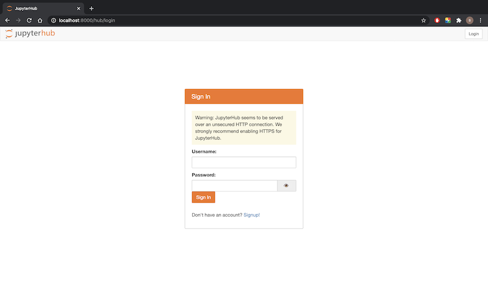
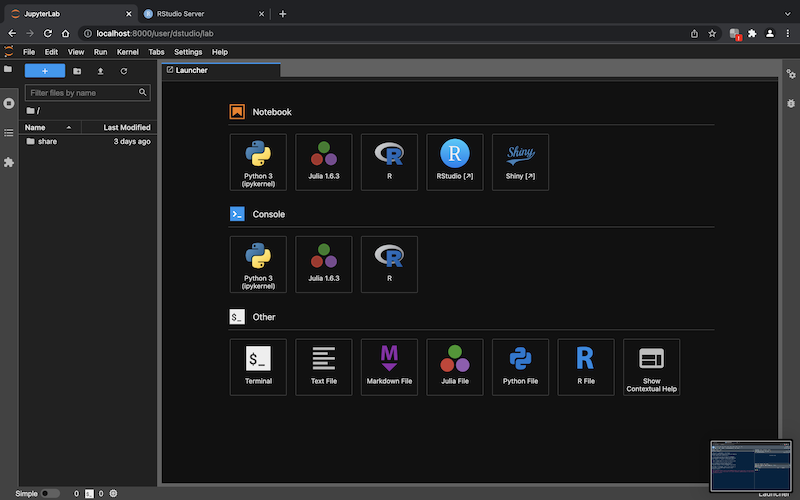

# dstudio: 基于 Jupyter 生态的在线建模分析协作平台

<!-- badges: start -->
<!-- badges: end -->

dstudio 是一个基于 [jupyterhub](https://hub.docker.com/r/jupyterhub/jupyterhub/tags) 和 [jupyterlab](https://hub.docker.com/r/jupyter/datascience-notebook/) 容器构建的数据分析平台，集成了 [rstudio server](https://posit.co/download/rstudio-server/) 与 [shiny server](https://posit.co/download/shiny-server/) 旨在简化在线建模分析与展示平台的搭建流程。部署后支持多用户通过浏览器远程访问 R 、Python（Julia）计算环境，并发布 shiny 应用，既能充分利用服务器计算资源，又便于团队协作与环境管理。本项目作为开箱即用的免费开源方案，适用于中小型团队及个人场景。

## 核心组件

dstudio 包含 dstudio_hub 和 dstudio_lab 两个容器（image），
- 其中，dstudio_hub 为用户管理中心，负责身份验证、权限管理，并为每位用户动态创建独立的 dstudio_lab 计算容器；
- dstudio_lab 为集成开发环境镜像，包含 JupyterLab、RStudio 等 IDE，支持 Shiny 数据可视化，预安装常用工具包。



## 快速入门

### 环境准备

需要提前安装 Docker 环境，安装指南参考 [docker 官方文档](https://docs.docker.com/get-started/)。

### 获取镜像

如果服务器能够直接连接互联网，在终端中运行以下代码即可直接从 [dockerhub](https://hub.docker.com/repositories) 下载使用到的两个 docker image；

```
# 拉取核心镜像 dstudio_hub 和 dstudio_lab
docker pull shichenxie/dstudio_hub:5.2.0 # 用户管理服务
docker pull shichenxie/dstudio_lab:5.2.0 # 管理员计算环境（含完整功能）
docker pull shichenxie/dstudio_lab:5.2.0ds # 普通用户计算环境（限制文件下载）(可选)
```

如果服务器没有互联网连接，可以先将拉取的镜像保存为离线文件，再拷贝至服务器加载。

```
# 导出镜像为 tar 包
# docker save shichenxie/dstudio_hub:5.2.0 -o ~/Downloads/dstudio_hub.tar
# docker save shichenxie/dstudio_lab:5.2.0 -o ~/Downloads/dstudio_lab.tar
# docker save shichenxie/dstudio_lab:5.2.0ds -o ~/Downloads/dstudio_lab_ds.tar

# 在服务器上加载镜像
# docker load --input dstudio_hub.tar
# docker load --input dstudio_lab.tar
# docker load --input dstudio_lab_ds.tar
```

### 启动服务

**下载配置文件** 可以直接通过命令行的形式下载，也可以手动复制保存。

```
curl -OL https://raw.githubusercontent.com/ShichenXie/dstudio/master/5.2.0/docker-compose.yml
```

**启动与停止服务** 然后在 terminal 中进入配置文件 docker-compose.yml 文件所在的目录

```
# 启动服务
docker-compose up -d

# 停止服务
# docker-compose down
```

### 访问地址

- **本地部署**：`http://localhost`
- **服务器部署**：http://服务器IP （需开放 80 端口）

## 使用指南

### 用户管理

- **注册与登录**：所有用户首次访问需点击 Signup 注册账号，管理员账号默认无需审批，普通用户需管理员在 Hub Control Panel （ http://localhost/hub/authorize ）中授权。

- **默认管理员**：初始管理员用户名为 dstudio，可通过 docker-compose.yml 中 HUB_ADMIN 参数自定义。

- **密码修改**：`http://localhost/hub/change-password`




### 文件存储

- **个人目录**：每个用户登陆之后默认进入 `～/work` 文件夹，该文件夹将默认固化至 `jupyterlab-user-xxx` volume（xxx 为用户名），从而持久化保存用户的个人文件。在服务器的 terminal 中可通过 `docker volume ls` 查看所有 volume。

- **共享目录**：在 `～/work` 文件夹中还有一个 share 文件夹链接指向 `～/share`，这个文件夹内的任何修改将固化至 `jupyterlab-share` volume。所有用户的 share 文件夹都固化至同一个 volume，从而实现多用户之间的文件共享。

- **本地映射**：如果在个人电脑上使用，可以将 `～/work` 文件夹指向个人电脑的文件夹，需要将 docker-compose.yml 中的 LAB_DIR_HOST 参数配置为对应文件夹路径。

### 文件下载权限

文件的下载功能仅限管理员用户。普通用户如果需要下载文件可以保存至共享文件夹 `～/share`，再由管理员下载。如果希望普通用户也拥有文件下载功能，可以将 docker-compose.yml 中的 LAB_IMAGE_USER 参数设置成与 LAB_IMAGE_ADMIN 的一致。

## 计算环境

### 开发工具

- **JpyterLab**: 默认主页，支持 Python/Julia 开发，访问路径为 `http://localhost/user/<用户名>/lab`。

- **RStudio Server**：修改URL为 `http://localhost/user/<用户名>/rstudio`，支持 R 语言开发。 

- **语言互通**：R 环境通过 [reticulate 包](https://rstudio.github.io/reticulate/)调用 Python；Python 环境通过 [rpy2 包](https://rpy2.github.io/) 调用 R。

### shiny 服务

- **访问方式**：可通过主页按钮直接进入 Shiny 页面，访问路径为 `http://localhost/user/<用户名>/shiny`

- **自定义部署**：将自定义 Shiny 应用存放至容器内 /srv/shiny-server 目录，修改后需要固化容器，重启服务后，所有用户均能访问 shiny 应用。 

### 定时任务

在 jupyterlab 或 rstudio server 页面的 terminal 窗口中，执行 cron service start，通过 [cronR 包](https://github.com/bnosac/cronR) 管理定时任务。


### 待完善功能

- 增加集群支持，目前还只支持单服务器。

## 贡献与参考

欢迎通过 GitHub 提交 Issue 或 Pull Request，期待您的反馈与合作！

本项目适合中小型团队在单服务器上搭建在线建模分析平台，参考了 [defeo/jupyterhub-docker](https://github.com/defeo/jupyterhub-docker) 与 [jupyterhub/jupyterhub-deploy-docker](https://github.com/jupyterhub/jupyterhub-deploy-docker)；对于大型团队需要集群扩展的可以参考 [zero-to-jupyterhub-k8s](https://zero-to-jupyterhub.readthedocs.io/en/stable/) 项目。
类似的项目还有 [ShinyStudio](https://github.com/dm3ll3n/ShinyStudio)，不过是基于  [shinyproxy](https://www.shinyproxy.io/) 开发的。

本项目参考了以下内容或项目：
- [Docker — 从入门到实践](https://yeasy.gitbook.io/docker_practice/)
- [A Docker tutorial for reproducible research.](http://ropenscilabs.github.io/r-docker-tutorial/)
- [Jupyter](https://jupyter.org/), [JupyterHub](https://jupyterhub.readthedocs.io/)([jupyterhub-deploy-docker](https://github.com/jupyterhub/jupyterhub-deploy-docker)), [DockerSpawner](https://jupyterhub-dockerspawner.readthedocs.io/), [JupyterHub Native Authenticator](https://native-authenticator.readthedocs.io/en/latest/)
- [jupyter-rsession-proxy](https://github.com/jupyterhub/jupyter-rsession-proxy)
- [RStudio Server Pro - Administration Guide](https://docs.rstudio.com/ide/server-pro/latest/)
- [Version-stable Rocker images](https://github.com/rocker-org/rocker-versioned)
- [traefik-book](https://www.qikqiak.com/traefik-book/), [traefik-proxy](https://jupyterhub-traefik-proxy.readthedocs.io/en/latest/install.html)

